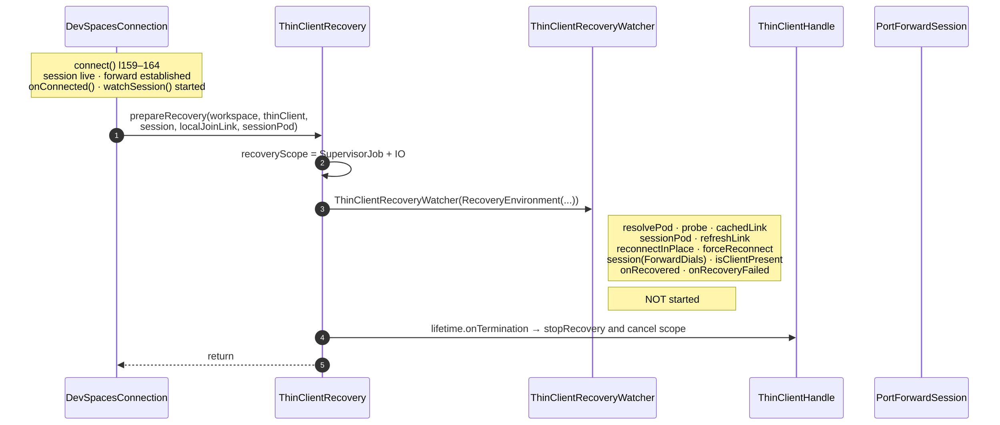
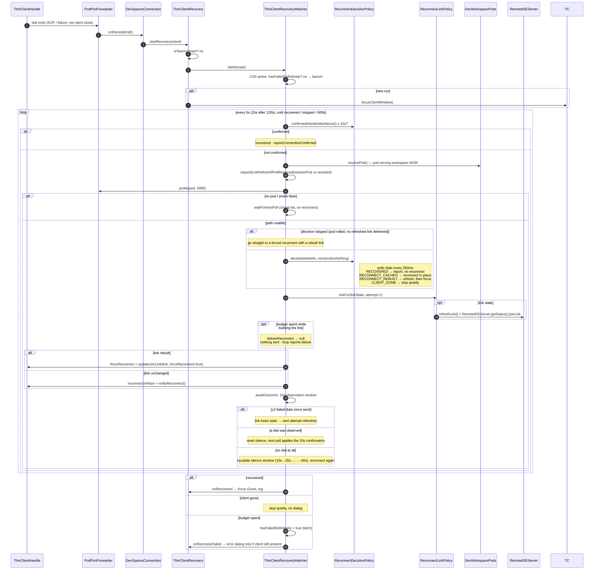
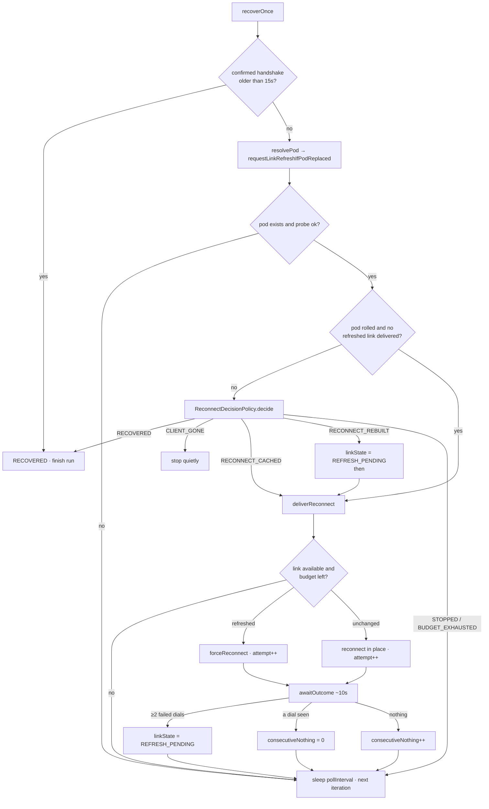

# Thin-Client Recovery: from `connect()` to a re-dialing Guest

How an open JetBrains Client survives an outage of the port forward without being closed or
relaunched: the plugin arms a recovery watcher on the live session, the forward's remote-end signal
starts it, and the watcher asks the existing Guest to re-dial until a dial proves a session.

Two levers are used, and the join link decides which:

- **reconnect in place** — `ThinClientHandle.notifyReconnect()` makes the Guest re-dial the link it
  last stored without disposing the project. The window and frame stay. Used whenever the link did
  not change: a network cut, a VPN drop, a laptop sleep, or a Guest that stopped re-dialing.
- **forced reconnect** — `updateJoinLink(link, forceReconnect = true)` disposes and re-opens the
  project to adopt a **rebuilt** link. Used only when the link really changed: a replaced pod, an
  IDE server restarted in place, or a workspace stopped and started again. The frame swap is
  inherent and accepted there.

Sources:

- `DevSpacesConnection.kt` — connection lifecycle, `prepareRecovery` call, teardown
- `recovery/ThinClientRecovery.kt` — per-session wiring, start/stop, the two reconnect levers
- `recovery/ThinClientRecoveryWatcher.kt` — the recovery run loop
- `recovery/ReconnectDecisionPolicy.kt` — "can the Guest's own loop still recover?"
- `recovery/ReconnectLinkPolicy.kt` — which link a reconnect may carry
- `openshift/PodPortForwarder.kt`, `openshift/SessionPhase.kt` — dial recording, stalled-dial
  classification and `onRemoteEnd`
- `openshift/PortForwardSession.kt` — `ForwardDials`, the watcher's read-only view of the forward
- `ThinClientJoinLink.kt` — rewrites the reported link onto the local port, adds the reconnect nonce

---

## 1. Where `prepareRecovery` sits

`DevSpacesConnection.connect()` has already finished the hard part when it reaches
`recovery.prepareRecovery(...)`:

| step | line | meaning |
|---|---|---|
| `waitUntilServerReady` | 139 | workspace Running + IDE server Ready + join link |
| `startPortForward` | 150 | loopback listener → pod:5990, retry/retarget wired |
| `startClient` / `waitForConnect` | 157–160 | Guest is up |
| `setSessionLive(true)`, `markEstablished()`, `onConnected()` | 162–164 | session is live |
| `watchSession` | 165 | restart annotation; workspace stop cuts the connections (§3) |
| **`prepareRecovery`** | **168** | **arm recovery — build, do not start** |

The pod identity passed as `sessionPod` (`remoteIdeServer.pod`) is the identity the cached join link
was minted against. That value is what later lets recovery tell "same pod, transient outage" from
"pod rolled, link is stale by definition".

Construction tolerates a pod that is not ready *yet*: `RemoteIDEServer` resolves the newest running,
non-terminating pod (`findServingPod(..., requireReady = false)`), so a pod that runs but has not
passed its readiness probe does not abort the connect. `waitUntilServerReady` polls it and retargets
through `refreshPod()` once a ready pod appears. `resolvePod` inside a recovery episode still requires
readiness: a not-ready pod cannot carry a session yet.

---

## 2. What `prepareRecovery()` does

`ThinClientRecovery.prepareRecovery` (l89–130) is pure wiring. It:

1. creates `recoveryScope = CoroutineScope(SupervisorJob() + Dispatchers.IO)` — the scope that will
   own the recovery loop;
2. builds one `ThinClientRecoveryWatcher` with a `RecoveryEnvironment` of closures, **not** live
   objects: pod resolver, probe, cached link, session pod, link refresher, the in-place reconnect
   lever (`notifyReconnect`), the forced-reconnect lever (`updateJoinLink(forceReconnect = true)`),
   `session` (the `ForwardDials` view of the forward), client-presence check, and two outcome
   callbacks;
3. hooks `thinClient.lifetime.onTermination { stopRecovery(); scope.cancel() }`.

Nothing runs. The Guest may be perfectly healthy, so arming costs nothing.

---

## 3. What starts it: the forwarder's remote-end signal

Recovery is never started by the platform, only by *this* forward. When a copied connection ends and
it was not a clean client-side close, `PodPortForwarder.handleEnded` (l345–357) calls
`state.onRemoteEnd()` — the lambda `DevSpacesConnection.startPortForward` (l205–219) installed, which
routes to `DevSpacesConnection.onRemoteEnd(attempt.thinClient)` →
`ThinClientRecovery.startRecovery`.

The workspace stop produces the same signal: `DevWorkspaceSessionWatch` reports the stop and
`DevSpacesConnection.onWorkspaceStopped` (l278–282) cuts the copied connections
(`PortForwardSession.dropClientConnections`), so the Guest reads EOF at once instead of waiting for
the pod to terminate. The cut ends the copy like a pod-side loss — the episode starts immediately —
while recovery and the listener stay armed, so a workspace started again is reconnected (§6).

`startRecovery` (l144–157) is where the safety lives:

- `isTearingDown()` (backed by `currentAttempt.tearDownStarted`) → refuse: a connection already ending
  must not begin recovery;
- `watcher == null || scope == null` → nothing armed;
- `watcher.start(scope)` returns `true` **only for the first signal of an outage**
  (`active.compareAndSet(false, true)` plus the `hasFailedDefinitively` latch);
- the accepted run owns `active` (`activeOwner`): only it releases the latch in its `finally`. A
  superseded run that finishes after a replacement started cannot clear the replacement's latch;
- focus is requested once per new run: `focusClientWindow()` is called directly, only when
  `watcher.start(scope)` reports a new episode, so a Guest that re-dials every ~4.5 s does not yank
  the window forward repeatedly. The episode latch is the gate; there is no time-based throttle.

---

## 4. The recovery run loop

`recoverUntilStopped(owner)` (l305–332) creates one `RecoveryRun` and loops while active, unfinished,
and inside the 600 s budget. Each iteration is `step()` → `recoverOnce()` (l360–411):

### Per-iteration decision tree

---

## 5. The invariants that make it safe

- **Survival, not bytes, confirms a session.** Any reconnect request only proves a message was
  queued. A dial counts only after `DIAL_CONFIRMATION_MS` = 15 s
  (`SessionPhase.kt`), because a stale-link dial is copied for 6.5–6.9 s and then dropped.
- **A dial stalled by an outage is not stale-link evidence.** A socket accepted before connectivity
  returns keeps retrying inside the forwarder and handshakes only when the network is back. If the
  Guest drops it right after, `SessionPhase` does not count it as a failed dial: the link was never
  given a fair chance, and the drop is the outage settling. This is the live 2026-11-25 regression:
  a five-minute cut produced a burst of such drops, the watcher declared the link stale, and the
  resulting forced reconnect swapped the frame even though a healthy dial was already about to
  confirm. Which side ends a prompt dial instead does *not* matter: a restarted IDE server ends a
  stale-token dial itself (pod side) while the Guest's transport timeout ends it client side — both
  are the stale-link signature. Excluding pod-side ends was the live 2026-11-26 regression: the
  same-pod server restart produced no stale-link evidence at all, so the watcher kept re-dialing the
  dead link until its budget ran out. A prompt handshake dropped inside the window still counts —
  that is the stale-link signature.
- **Pod identity, not dial lifetime, detects a roll.** A new pod = new idea-server = new `jt`/`fp`
  tokens; the cached link cannot work however long the dial survives. `requestLinkRefreshIfPodReplaced`
  flips `LinkState` to `REFRESH_PENDING`.
- **A stale link is never sent again.** Within an episode `LinkState` is monotone
  `CACHED → REFRESH_PENDING → DELIVERED_REFRESHED`; `ReconnectLinkPolicy.linkFor` returns `null`
  (keep polling) rather than reuse the link the episode proved stale. Two forced reconnects with a
  stale link made the Guest exit with 178 in CRW-13910.
- **An unchanged link is reconnected in place, never force-reconnected.** `notifyReconnect()` makes
  the Guest re-dial its last stored link without disposing the project, so the window and frame
  stay. `updateJoinLink(forceReconnect = true)` is reserved for a rebuilt link: only then is the
  project-level restart necessary, and only then is the frame swap accepted.
- **Nothing is sent after the budget.** Building a stale link runs a status exec that can outlast the
  remaining budget; `deliverReconnect` rechecks the budget *after* the build and sends nothing, so
  the Guest's window is not swapped right before the failure is reported. The loop then exits on the
  same budget check and reports failure once.
- **A link rewrite preserves the link byte for byte.** `ThinClientJoinLink.toLocal` and
  `withReconnectNonce` reassemble the raw components and parse the text (`URI(String)`): the
  multi-argument `URI(scheme, authority, path, query, fragment)` constructor re-encodes existing
  escapes (`%20` → `%2520`), which would make the Guest dial a different link. `//` is added only
  when an authority exists.
- **The session adopts what the recovery proved.** A confirmed recovery makes the delivered refreshed
  link and the pod that served it the session's new baseline. The next outage starts from that
  link/pod, not from the connect-time pair it just replaced. A later forced delivery of an adopted
  link carries a nonce, because the Guest already has that link text and its same-link guard would
  otherwise swallow the message. An in-place reconnect needs no nonce: it is a different wire
  message, not an identical `UpdateLink`.
- **A forced reconnect is the last resort.** It is a project dispose/reopen (window swap), so the
  Guest's own seamless loop is given its chance first via `ReconnectDecisionPolicy`; silence
  windows escalate 10→60 s so the Guest is not hammered into closing itself. The post-reconnect
  observation window only classifies dial activity (failed run vs. answered vs. nothing); the 15 s
  survival confirmation is applied by the next loop poll.
- **One run per outage, one failure per session.** `active` guards restarts and is owned by the run
  that set it (`activeOwner`): a superseded run finishing late cannot release a replacement's latch.
  `hasFailedDefinitively` latches after a spent budget, so post-failure dial churn does not begin
  another 600 s run and re-report.
- **A workspace stop is an outage, not an end.** The stop cuts the copied connections but leaves
  recovery armed and the listener open, because a stopped workspace can be started again. Nothing
  reconnects into the stopped workspace: while no Running+Ready pod serves it, `resolvePod` answers
  `null` and the loop only polls, and a forced reconnect needs a freshly reported link, which only
  the new pod's IDE server produces. The restart then runs the pod-roll path end to end.
- **Recovery never starts or closes a client.** It only observes the existing Guest and asks it to
  re-dial. Client lifetime is the watcher's stop signal.

---

## 6. How recovery ends and why teardown cares

`stopRecovery()` (`ThinClientRecovery` l168–173) reads `isActive` **before** stopping and returns it.
`tearDownConnection` (`DevSpacesConnection` l315–357) uses that flag: if a recovery was running when
the Guest closed, the remote `DevWorkspaces.stop(...)` is withheld (§7.9) — a workspace that may
return once the outage clears must not be shut down because the user gave up locally. Everything
else in teardown (clear tracking, notify UI, close client, close forwarder) is unchanged.

Recovery also ends on:

- **client gone** — `isClientPresent()` false: `stopQuietly`, no dialog;
- **lifetime termination** — `thinClient.lifetime.onTermination` stops the watcher and cancels the
  scope;
- **a new `connect()`** — `stopRecovery()` runs at the top of `connect` (l129) before a new attempt;
- **workspace stopped** — no longer ends recovery: `DevWorkspaceSessionWatch.onStopped` cuts the
  copied connections (Guest reads EOF at once) and keeps the forward listening, so a workspace
  started again is reconnected like a pod roll — see
  [crw-13910-behavior-changes.md](crw-13910-behavior-changes.md) §9. A stop the workspace never
  returns from ends the episode the ordinary way: the 600 s budget, one failure dialog.
